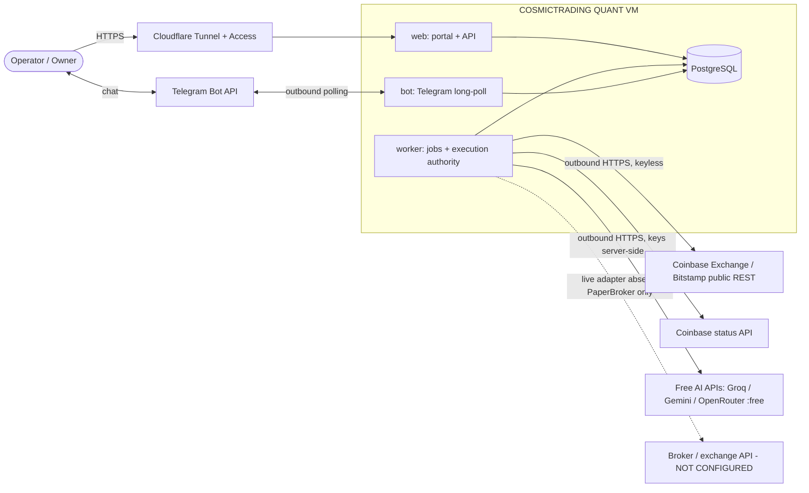

# 04 — System Architecture

## 1. Shape

COSMICTRADING QUANT is a **modular monolith**: one Python package (`cosmic`) built into one container image and run as three processes, plus PostgreSQL and (optionally) `cloudflared`.

| Process | Command | Why it is separate | Owner (module) |
|---|---|---|---|
| `web` | `cosmic web` (uvicorn, 1 worker) | Serves the operator portal and JSON API. Stateless; may restart freely. | `cosmic.web` |
| `worker` | `cosmic worker` | Runs scheduled jobs (ingestion, freshness, missions, expiry sweeps, reconciliation, paper-broker matching) and holds the **single execution authority** (Postgres advisory-lock leader). Isolated so a slow request can never delay order handling, and vice versa. | `cosmic.worker`, `cosmic.trading.execution` |
| `bot` | `cosmic bot` (optional Compose profile) | Telegram long polling. Outbound only — there is no inbound webhook to forge. Disabled until a bot token exists. | `cosmic.notify.telegram` |
| `postgres` | PostgreSQL 17 | The only datastore: state, queue, audit, cache. | `cosmic.db` |
| `cloudflared` | optional profile | Outbound tunnel to Cloudflare; the only public path to `web`. | deploy |

No Redis, message broker, vector database, Kubernetes or microservices: none is justified by a measured need at this scale (ADR-003, ADR-005). The design keeps boundaries clean enough that `worker` could later be split by job class if measurements require it.

## 2. Context



## 3. Module map and dependency rules

```
cosmic/
  core/        config, logging, ids, clock, money, labels, errors           (depends on nothing in cosmic)
  db/          engine, metadata, transactions, migrations                    → core
  audit/       hash-chained append-only events                               → core, db
  identity/    users, sessions, MFA, CSRF, RBAC capabilities                 → core, db, audit
  sources/     source registry, connector contract, connectors, freshness    → core, db, audit
  market/      instruments, bars/quotes, indicators, stats, regime, events   → core, db, sources
  evidence/    documents, claims, contradictions                             → core, db, sources
  trading/     authority, risk, sizing, precision, proposals, approvals,
               orders, brokers, execution, ledger, reconcile, killswitch,
               management, monitor, review, golive                           → core, db, audit, identity, market
  ai/          gateway, registry, policy, adapters, breaker, quota, cache    → core, db, audit
  research/    strategies, experiments, backtest, opportunities, reports     → core, db, market, evidence
  workforce/   roles, tasks, missions, tools                                 → core, db, ai, research, market, evidence, trading.proposals (propose only)
  notify/      outbox, Telegram adapter + handlers                           → core, db, identity, trading (service API)
  ops/         health, metrics, resources, incidents                         → core, db
  web/         FastAPI app, portal views, API routers                        → everything above (thin handlers)
  worker/      scheduler, job runner, execution loop                         → everything above
  cli.py       entry points                                                  → web, worker, notify, db
```

Enforced rules (import-contract tests in `tests/unit/test_architecture.py`):

1. `cosmic.trading`, `cosmic.audit`, `cosmic.identity` **never import** `cosmic.ai` or `cosmic.workforce` (AI-23, PRIN-02).
2. Only `cosmic.ai.adapters` performs HTTP to AI providers; only `cosmic.sources.connectors` performs HTTP to data sources; only `cosmic.trading.brokers` talks to brokers.
3. `cosmic.workforce` may call `trading.proposals.create_candidate()` and read-only risk evaluation; it cannot import `trading.execution`, `trading.approvals`, `trading.brokers` (TRD-06, SEC-11).
4. `web` and `notify` handlers contain no business rules; both call the same service functions (ARC-03).

## 4. Key runtime flows

### 4.1 Discovery → proposal → approval → execution (paper)

```mermaid
sequenceDiagram
  autonumber
  participant W as worker (scheduler)
  participant M as market/sources
  participant R as research + workforce
  participant AI as AI gateway (free only)
  participant RK as risk engine (deterministic)
  participant P as proposals/approvals
  participant O as Operator (portal / Telegram)
  participant X as execution authority
  participant B as PaperBroker (SIMULATED)
  participant L as ledger/reconcile
  W->>M: ingest bars/quotes (keyless REST), freshness + cross-source checks
  M-->>R: material-change event
  R->>R: quant analysis (indicators, regime, backtest) — deterministic
  R->>AI: narrative + counterarguments over evidence refs (optional)
  AI-->>R: schema-validated JSON, claims verified by code
  R->>P: candidate intent (structured)
  P->>RK: pre-approval checks (12 areas)
  RK-->>P: PASS → packet v1 (hash) / FAIL → NON_EXECUTABLE + reasons
  P->>O: approval request (exact terms, expiry)
  O->>P: review → confirmation challenge → confirm (+ step-up MFA)
  P->>P: approval row bound to packet hash, policy version, nonce, expiry
  X->>P: consume approval atomically (single use)
  X->>RK: revalidate now (mode, account, price band, freshness, portfolio veto)
  X->>X: persist order SUBMITTING (client_order_id = f(intent))
  X->>B: submit (typed request rebuilt from approved params)
  B-->>X: ack / reject / timeout
  X->>X: ACKNOWLEDGED / REJECTED / UNKNOWN_ORDER_STATE
  B-->>X: fills (polled)
  X->>L: ledger entries; positions; approved exits only
  L->>L: reconcile broker ↔ internal
  X->>O: notify actual broker-confirmed state
```

### 4.2 Order state machine

See `diagrams/order-state-machine.md`. Transitions are code-defined (`trading/orders/states.py`); every transition writes an `order_events` row in the same transaction; `UNKNOWN_ORDER_STATE` is resolved only by reconciliation.

### 4.3 Authority modes

See `diagrams/authority-modes.md` and ADR-010. Mode is persisted in `authority_state` (single row, versioned). `APPROVED_EXECUTION` is a per-order authority derived from a valid approval, not a global switch.

### 4.4 Kill switch

`EMERGENCY_STOP` is set by one `UPDATE authority_state` in a transaction that also revokes queued approvals. Every submission transaction takes `FOR SHARE` on the same row, so a submission either commits before the stop (and is then handled as in-flight) or sees the stop and aborts. Documented residual window: an order already persisted as `SUBMITTING` is transmitted; it is then reconciled and handled under the emergency policy.

## 5. Data ownership

| Data | Owner module | Writers | Notes |
|---|---|---|---|
| users, sessions, MFA | identity | web | MFA secrets AES-GCM encrypted with the app key |
| audit_events | audit | all modules via `audit.record()` | INSERT-only; DB trigger computes hash chain |
| sources, fetch_runs, bars, quotes, instruments | sources/market | worker | Idempotent upserts keyed by natural keys |
| documents, claims, contradictions | evidence | worker | Content stored as untrusted text |
| ai_* | ai | worker, web (attestations) | Keys never stored in DB |
| tasks, missions, artifacts | workforce | worker | |
| strategies, backtests, opportunities | research | worker | Versioned, hash-addressed |
| authority_state, risk_policies, trade_intents, approval_packets, approvals, orders, order_events, fills, ledger_entries, positions, reconciliation_* | trading | web (decisions), worker (execution) | Immutable rows where the directive requires it |
| paper_* | trading.brokers.paper | PaperBroker only | Separate "venue truth" so reconciliation is meaningful |
| jobs, worker_heartbeats, incidents, notifications | ops/worker/notify | worker, web, bot | |

## 6. Trust boundaries

See `diagrams/trust-boundaries.md` and doc 09. Boundaries: Internet ↔ Cloudflare edge; Cloudflare ↔ `web` (tunnel, Access, app auth); Telegram ↔ `bot` (user-ID binding); `worker` ↔ external data/AI (untrusted inputs, SSRF guard, schema validation); research/AI ↔ trading (typed candidate only); application ↔ database (role separation, immutable tables); execution ↔ broker (adapter contract, least-privilege credentials).

## 7. Failure behaviour (summary)

| Failure | Behaviour |
|---|---|
| All AI providers down / quota exhausted | AI tasks wait (`WAITING_FOR_AI`); no new AI-researched proposals; risk, approvals, execution, reconciliation, kill switch unaffected |
| Market data stale or sources disagree | Dependent exposure-increasing actions blocked (`STALE` / `CONTRADICTED`), UI labels change |
| Broker timeout / ambiguous response | `UNKNOWN_ORDER_STATE`, account flagged, reconciliation job; no resubmission |
| Worker crash mid-submission | Startup sweep moves `SUBMITTING`/unacknowledged orders to `UNKNOWN_ORDER_STATE` and reconciles by client order ID |
| Database unavailable | `web` readiness fails, `worker` pauses and retries with backoff; no trading action proceeds without a transaction |
| Disk/memory pressure | Background research paused (priority shedding); safety jobs continue; incident raised |
| Telegram unavailable | Portal remains the approval route; notification delivery failures recorded |
| Tunnel down | App and trading safety unaffected; operator uses LAN/SSH access per runbook |

## 8. Technology summary

Python 3.12 · FastAPI · Jinja2 (server-rendered, no SPA) · Pydantic v2 / pydantic-settings · SQLAlchemy 2 Core + asyncpg · Alembic (SQL migrations) · PostgreSQL 17 · httpx · structlog · argon2-cffi · pyotp · cryptography (AES-GCM) · aiogram 3 (bot) · pytest + hypothesis · ruff · mypy (strict) · Docker Compose · cloudflared. Rationale in ADR-004 to ADR-006.
