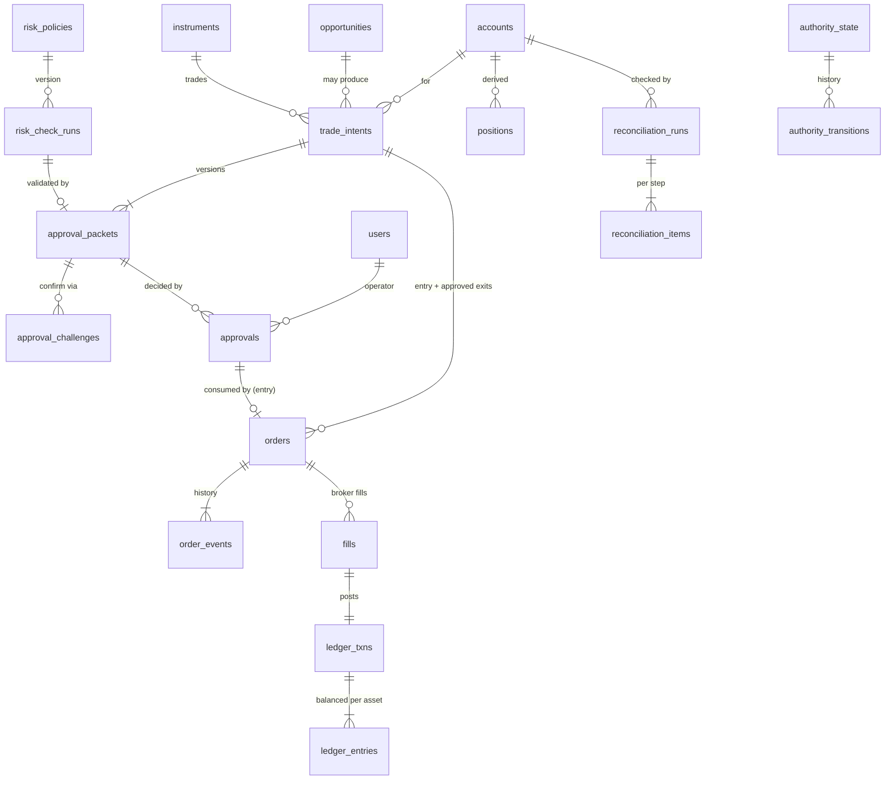

# 05 — Data Architecture and ERD

## 1. Conventions

| Rule | Implementation |
|---|---|
| Identifiers | UUIDv7 (time-ordered, RFC 9562) generated in Python (`core.ids.uuid7`). Human-facing trade IDs (`T-20261010-7F3K`) are separate unique codes, never used as foreign keys. |
| Time | `timestamptz` everywhere, stored and compared in UTC. Source-local timezone is recorded as metadata (`sources.timezone`, `instruments.timezone`). |
| Money, prices, quantities | `NUMERIC(38,18)` in the database, `decimal.Decimal` in Python (context precision 50). No `float`/`double precision` column exists in any financial table (schema test). Indicators and backtest statistics may use floats; they are analytics, never ledger truth. |
| Immutability | Rows that the directive requires to be append-only (`audit_events`, `order_events`, `fills`, `ledger_entries`, `ledger_txns`, `approval_packets`, `authority_transitions`, `risk_check_runs`, `golive_gates`) are protected twice: the runtime role has only `INSERT, SELECT`, and a trigger raises on `UPDATE`/`DELETE`/`TRUNCATE` for every role. `trade_intents` allows updates only to `status`, `status_reason`, `updated_at` (trigger-enforced). |
| Idempotency | Natural unique keys: `bars(instrument_id, source_id, timeframe, open_time)`, `fills(order_id, broker_fill_id)`, `orders.client_order_id`, `jobs.idempotency_key`, `tasks.idempotency_key`, `missions.idempotency_key`, `market_events.dedup_key`, `incidents.dedup_key` (open only), `notifications.dedup_key`. |
| Database roles | `cosmic_owner` owns schema and runs migrations; `cosmic_app` is the runtime role (DML on mutable tables, `INSERT, SELECT` on immutable ones, no DDL, no `TRUNCATE`). The PostgreSQL superuser is used only by the bootstrap step. |
| Migrations | Alembic revisions containing explicit SQL; a drift test compares the migrated database with the SQLAlchemy Core metadata. Every revision has a tested `downgrade()` except where data loss would result (documented in the revision). |
| Sensitive data | Password hashes (argon2id), session token **hashes** (SHA-256), MFA secrets encrypted with AES-GCM under the application key. No API keys, tunnel tokens or broker secrets are stored in the database. |

## 2. Entity groups

### 2.1 Identity and access

- `users` — `username` (unique, lower-case), `password_hash`, `roles text[]` (code-defined roles: `OWNER`, `ANALYST`, `VIEWER`), `mfa_secret_enc`, `mfa_enabled`, `telegram_user_id bigint unique` (immutable once linked; changing requires unlink + relink, audited), lockout counters.
- `sessions` — `token_hash` unique, `csrf_token`, absolute and idle expiry, `mfa_verified_at` (step-up), `revoked_at`.
- `telegram_link_codes` — one-time codes (hashed), 10-minute expiry, single use.

Capabilities are not stored per user; they derive from roles in code (`identity/capabilities.py`), so a capability change is a reviewed code change.

| Role | Capabilities |
|---|---|
| OWNER | all 12 + `ACTIVATE_EMERGENCY_STOP` + `VIEW` |
| ANALYST | `VIEW`, `READ_MARKET_DATA`, `READ_ACCOUNT`, `RESEARCH`, `PROPOSE_TRADE`, `ACTIVATE_EMERGENCY_STOP` |
| VIEWER | `VIEW`, `READ_MARKET_DATA` |
| (service) `research-worker` | `READ_MARKET_DATA`, `RESEARCH`, `PROPOSE_TRADE` |
| (service) `execution-authority` | `READ_ACCOUNT`, `SUBMIT_ORDER`, `CANCEL_ORDER`, `MANAGE_APPROVED_POSITION`, `RECONCILE` |

Step-up MFA (TOTP verified within 10 minutes) is required for: `APPROVE_TRADE`, `CHANGE_RISK_LIMITS`, `ENABLE_STRATEGY_AUTHORITY`, `ADMINISTER_SYSTEM`, resuming from `EMERGENCY_STOP`, AI attestation/approval. Activating the kill switch needs only an authenticated session with `ACTIVATE_EMERGENCY_STOP`.

### 2.2 Audit

`audit_events(seq bigint PK, id uuid, occurred_at, actor_type, actor_id, action, entity_type, entity_id, correlation_id, payload jsonb, prev_hash, hash)`. A `BEFORE INSERT` trigger takes a transaction-scoped advisory lock, assigns `seq = last + 1`, sets `prev_hash` to the previous row's hash and computes `hash = sha256(prev_hash | seq | occurred_at(UTC, µs) | actor | action | entity | correlation | payload::text)`. `audit_verify()` recomputes the chain and reports the first broken or missing sequence number. Convention: audit writes are the last statement of a transaction to keep the lock short.

### 2.3 Operations

`jobs` (Postgres queue: `status`, `priority`, `run_at`, `attempts`, `locked_by`, `locked_until`, `idempotency_key`), `worker_heartbeats`, `incidents` (dedup by `dedup_key` while open; severity; acknowledgement), `notifications` (outbox with delivery status and failures), `system_settings` (audited runtime settings).

### 2.4 Sources, market data, evidence

- `sources` — the full §6 metadata set: publisher, jurisdiction, language, access method, base URL, terms URL + review status, licence note, data class, latency class (`DELAYED_POLLING` for every current source), update frequency, freshness limit, timezone, known bias, owner, fallback, last success/error.
- `fetch_runs` — one row per fetch: counts received/new/rejected, HTTP status, sanitised error. Every market row references its fetch run (source vintage).
- `venues`, `assets`, `instruments` (`canonical_key` e.g. `SPOT:BTC/USD@COINBASE`, `pair_key` `BTC/USD`, tick, lot, min/max quantity, min notional, decimals, multiplier, settlement, session, timezone, status, metadata provenance), `instrument_listings` (source symbol ↔ instrument; tickers are never IDs).
- `bars` (PK instrument/source/timeframe/open_time; `is_complete` false for the still-open bar), `quotes`, `venue_status`, `data_quality_results`.
- `market_events` — deterministic material-change detections (`dedup_key` unique).
- `documents` (untrusted text, content hash), `claims` (status `VERIFIED` / `INFERRED` / `UNVERIFIED` / `CONTRADICTED`), `evidence_links`, `contradictions`.

### 2.5 AI gateway

`ai_provider_attestations` (owner attests account is on a free plan; expiry), `ai_model_approvals` (approved model IDs with evidence and review expiry), `ai_provider_state` (circuit breaker, rate-limit window, last success/error, disabled reason), `ai_usage` (one row per call: tokens, latency, HTTP status, reported cost), `ai_cache` (explicit `expires_at`). Provider endpoints and policies live in `config/ai_registry.toml` (reviewed in Git); keys live only in environment/secret files.

### 2.6 Workforce and research

`missions`, `tasks` (+ `task_deps`, `task_attempts`, `task_reviews`), `artifacts`, `escalations`; `strategies`, `strategy_versions` (params + code reference → hash), `backtest_runs` (data range, data vintage, assumptions, trial count, result + hash), `opportunities` (+ `opportunity_transitions`), `post_trade_reviews`.

### 2.7 Trading, ledger and reconciliation

Key constraints:

- `approval_packets.packet_hash` unique; `(intent_id, version)` unique; immutable.
- `approvals`: `nonce` unique; at most one `APPROVED` decision per packet (partial unique index); consumption is `UPDATE … SET status='CONSUMED' WHERE id=$1 AND status='ACTIVE' AND expires_at > now() RETURNING` — exactly one caller can win.
- `orders.client_order_id` unique and deterministic (`ct-<intent-short>-<purpose>-<n>`); one `ENTRY` order per intent (partial unique index); `reduce_only` true for every non-entry order.
- `ledger_entries`: deferred constraint trigger asserts Σ`amount` = 0 per (`txn_id`, `asset`) at commit.
- `accounts.reconciliation_status` ∈ `OK`, `REQUIRED`, `FAILED`, `UNKNOWN`; anything but `OK` blocks new exposure.
- `authority_state` is a single row (`id = 1` check) with a monotonically increasing `version`.
- `risk_policies`: exactly one `active` row (partial unique index); new versions are inserted, never edited.

### 2.8 Paper broker (simulated venue)

`paper_balances`, `paper_orders`, `paper_fills` are written only by `trading.brokers.paper`. They represent the simulated venue's own books, independent of the internal ledger, so reconciliation compares two genuinely separate records. Every row and every UI value derived from them is labelled `SIMULATED`.

## 3. Ledger model

Books per account and asset: `CASH` (spendable quote currency), `POSITION` (held base asset), `CLEARING` (trade settlement contra), `FEES` (fee expense), `CAPITAL` (paper capital contributions).

A buy fill of `q` BTC at price `p` with fee `f` USD posts one transaction:

| Book | Asset | Amount |
|---|---|---|
| POSITION | BTC | +q |
| CLEARING | BTC | −q |
| CLEARING | USD | +q·p |
| CASH | USD | −q·p |
| FEES | USD | +f |
| CASH | USD | −f |

Each asset sums to zero. Positions and cash are sums over books; `positions` is a derived cache rebuilt from fills and checked against the ledger during reconciliation.

## 4. Retention and volume (initial estimates, to be measured)

| Data | Growth | Retention |
|---|---|---|
| 1h bars, 2 venues × 2 instruments | ~35k rows/year | indefinite (small) |
| 5m bars (optional) | ~420k rows/year | 2 years |
| Quotes (60 s polling) | ~2.1M rows/year | 30 days raw, then hourly summary |
| Audit, orders, fills, ledger | low thousands/year in paper mode | indefinite (never pruned) |
| AI usage | ≤ a few thousand/day (quota-bound) | 1 year |
| Jobs (done) | ~50k/day | 14 days |
