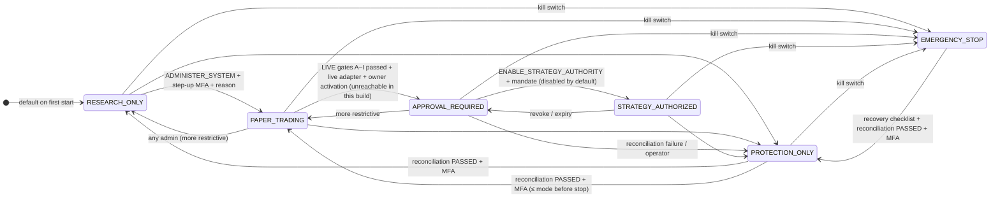

# Authority modes (V6 §1804, ADR-010)

`APPROVED_EXECUTION` is not a global mode: it is the authority attached to an individual order created from a valid, consumed approval (ADR-010). An environment cap (`COSMIC_MAX_AUTHORITY_MODE`) can only lower authority; if the stored mode exceeds the cap at startup the system enters `PROTECTION_ONLY` and raises an incident.
