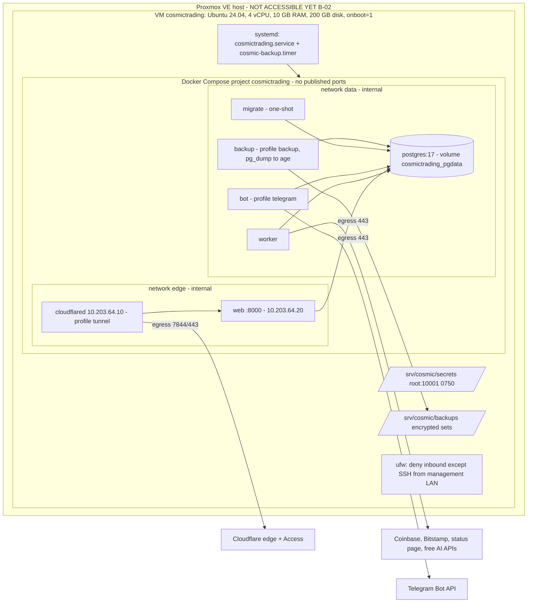

# Deployment topology (target: dedicated Proxmox VM)

As built in S9 (`deploy/compose.prod.yaml`). Verified locally in a production-like run; the VM itself is not accessible yet (B-02).

Networks: `edge` (internal: cloudflared ↔ web), `data` (internal: postgres and everything that uses it) and `egress` (worker, bot, cloudflared only). The web process has no route to the internet. Web trusts `X-Forwarded-For` only from cloudflared's fixed address. Before the tunnel exists, the owner reaches the portal through `compose.admin-access.yaml` (a relay on the VM's 127.0.0.1) and an SSH local forward.
