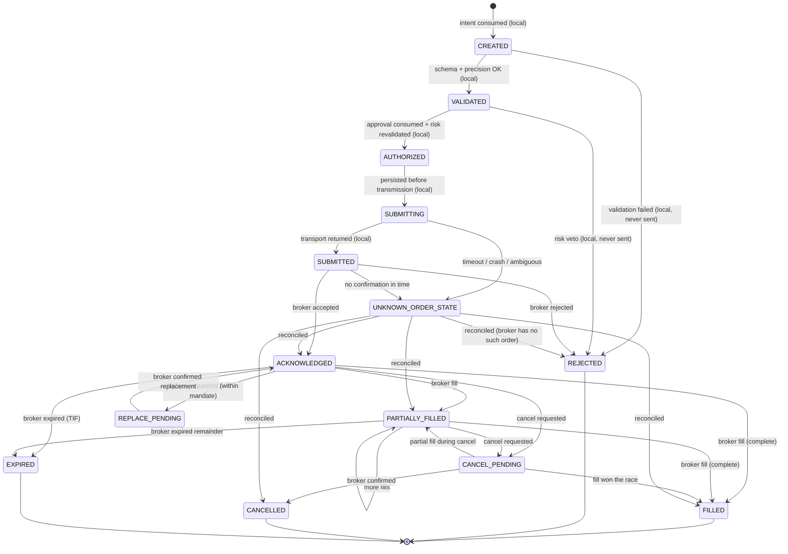

# Order state machine (V6 §1812)

Broker-grounded: a transition into `ACKNOWLEDGED`, `PARTIALLY_FILLED`, `FILLED`, `REJECTED`, `CANCELLED`, `EXPIRED` requires a broker response or reconciliation evidence. Local-only transitions are marked (local).

`UNKNOWN_ORDER_STATE → REJECTED` ("not found at broker") is allowed only after the broker's order lookup by client order ID returns a definitive not-found **and** a grace period has elapsed; otherwise the order stays unknown and is escalated.
